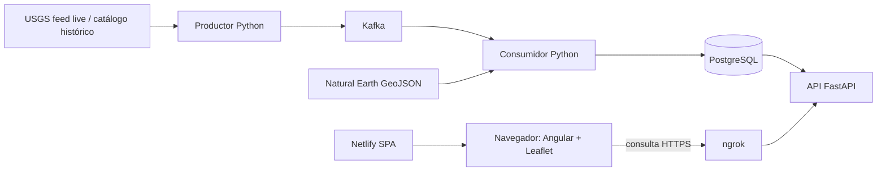

# Arquitectura y flujos

**Estado:** borrador de especificación pendiente de revisión del estudiante. Describe la arquitectura prescrita y alternativas de flujo admitidas; no acredita implementación ni aprueba decisiones de diseño abiertas.

## 1. Objetivo y alcance

Esta especificación concreta responsabilidades, límites y flujos principales del observatorio con base en el enunciado y el contrato mínimo de API. No prescribe modelo físico de datos, JSON detallado de estadísticas/salud, tópicos, listeners concretos de Kafka ni mecanismo único de carga histórica o aislamiento de replay.

La arquitectura obligatoria es cinco servicios backend separados en Docker Compose (productor, Kafka, consumidor, PostgreSQL y API FastAPI), frontend Angular como SPA en Netlify y acceso público a la API mediante ngrok durante la demostración. Fuente: [ENUNCIADO](../source-of-truth/ENUNCIADO.md), §2; despliegue, §9.

## 2. Componentes y responsabilidades

| Componente | Responsabilidad y límite | Naturaleza / fuente |
|---|---|---|
| USGS — feed live | Entregar por HTTP la ventana móvil `all_day.geojson`, consultada aproximadamente cada 60 s. No es push ni el día natural anterior; el feed puede retrasarse y revisar eventos. | Requisito docente: ENUNCIADO, §4.1. |
| USGS — catálogo histórico | Proporcionar consultas históricas; la extracción de trabajo confirmada es 2025, global, magnitud ≥4, tipo `earthquake`. Es una instantánea del catálogo, no un registro completo de todas las revisiones históricas. | Propuesta inicial del profesor confirmada por el estudiante: ENUNCIADO, §4.2; aclaración del estudiante registrada en [00](00-principios-y-alcance.md#supuestos-documentales-y-preguntas-abiertas). |
| Natural Earth | Aportar la copia geográfica incluida para fronteras y asignación espacial. `ADM0_A3` es identificador del catálogo y no debe asumirse como ISO oficial universal. | Requisito docente: ENUNCIADO, §4.3; [FUENTES-Y-LICENCIAS](../source-of-truth/FUENTES-Y-LICENCIAS.md), «Catálogo incluido». |
| Productor Python + aiokafka | Consultar USGS, comparar `id`/`updated`, publicar evento nuevo o revisión y registrar estado de publicación solo después de confirmación de Kafka. Puede formar parte de un flujo live o de una carga/replay, con identificación del modo. | Requisito docente: ENUNCIADO, §§2 y 5. |
| Kafka | Transportar y retener mensajes para desacoplar productor y consumidor. La clave exigida es el identificador de evento; el mensaje incluye `source`, `ingested_at`, `mode` (`live`/`replay`) y evento original. | Requisito docente: ENUNCIADO, §§2 y 5. |
| Consumidor Python + aiokafka | Validar, limpiar, transformar, enriquecer espacialmente, persistir y conservar rechazos con su motivo. La escritura debe tolerar reentrega; el offset se confirma después de la escritura persistida. | Requisito docente: ENUNCIADO, §§2, 6 y 7. |
| PostgreSQL | Persistir los datos necesarios para consulta y análisis, originales/versiones y estado de procesamiento conforme al modelo que se defina. Es el almacenamiento durable; no se prescribe aquí su esquema. | Requisito docente: ENUNCIADO, §§2, 5 y 7. |
| API Python + FastAPI | Consultar datos ya procesados en PostgreSQL y exponer los endpoints de lectura; no reemplaza el procesamiento del consumidor. `GET /api/eventos` tiene contrato mínimo definido; los payloads detallados de estadísticas y salud siguen pendientes. | Requisito docente: ENUNCIADO, §§2 y 8; [CONTRATO-API](../source-of-truth/CONTRATO-API.md), «GET /api/eventos» y «Otros endpoints a implementar». |
| Angular + Leaflet | Consumir la API, aplicar filtros coherentes y presentar mapa, tabla, gráficos, comparación y estado. No consulta directamente USGS como sustituto del flujo procesado. | Requisito docente: ENUNCIADO, §8. |
| Netlify | Servir el frontend compilado como SPA. El visitante descarga Angular desde Netlify; el backend puede no estar disponible cuando el equipo local esté apagado. | Requisito docente: ENUNCIADO, §§2 y 9. |
| ngrok | Terminar HTTPS público hacia la API local; no es autenticación ni motivo para exponer broker, base de datos o rutas de administración. | Requisito docente: ENUNCIADO, §9; CONTRATO-API, «Acceso desde Netlify» y «Transporte y contenedores». |

### Límites de responsabilidad

- **Productor:** extrae y publica novedades/versiones; no transforma su envío en resultado analítico ni marca una publicación antes de recibir confirmación Kafka. (ENUNCIADO, §5.)
- **Consumidor:** es responsable de validación, transformación, integración, persistencia y cuarentena. El trabajo durable debe ocurrir antes de confirmar el offset. (ENUNCIADO, §§6–7.)
- **PostgreSQL:** es fuente consultable de datos procesados para la API; el modelo y las tablas se especifican aparte. La API no debe simular un resultado válido de cero si falla la base. (ENUNCIADO, §§2, 7; CONTRATO-API, «Otros endpoints a implementar».)
- **API:** sirve datos procesados, aplica filtros equivalentes para mapa/estadísticas y hace explícitos los errores; no calcula que una ingesta está activa solo porque pudo generar una respuesta. (CONTRATO-API, «GET /api/eventos» y «Otros endpoints a implementar».)
- **Frontend:** consulta y representa la API; ante fallo conserva/identifica la última lectura y avisa, no presenta datos antiguos como recién obtenidos. La guía del material base describe conservación de capa y timeout del componente de apoyo. (ENUNCIADO, §8; README del material base, §3.)

## 3. Vista de arquitectura

El esquema muestra responsabilidades y conexiones previstas, no configura redes, puertos internos de Kafka ni un despliegue de ngrok específico. Las cinco cajas backend deben ser cinco servicios Compose separados. (ENUNCIADO, §2.)

La relación del navegador con el frontend alojado en Netlify y sus consultas HTTPS a la API mediante ngrok se indican en ENUNCIADO, §§2 y 9, y CONTRATO-API, «Transporte y contenedores». El diagrama no implica que Netlify ejecute el frontend dentro del backend local.

## 4. Flujos

### 4.1 Ingesta live

1. El productor consulta por HTTP GET el feed móvil de las últimas 24 horas aproximadamente cada 60 segundos. Filtra `properties.type == "earthquake"` y registra el motivo de exclusión de otros tipos. (ENUNCIADO, §§4.1 y 5.)
2. Compara identificador `id` y `updated` con el estado persistido de lo ya publicado; publica un evento nuevo o una revisión posterior y omite versiones ya conocidas. (ENUNCIADO, §5.)
3. Publica el evento con clave Kafka igual al identificador; el mensaje incluye `source`, `ingested_at`, `mode=live` y el original. Espera el ACK de Kafka antes de registrar la versión como publicada. (ENUNCIADO, §5.)
4. El consumidor lee el mensaje, valida y transforma; realiza la asignación geográfica, persiste la versión/estado necesario y conserva rechazos y motivos. (ENUNCIADO, §§4.3, 6 y 7.)
5. El consumidor confirma el offset después de que la escritura se haya confirmado. Una reentrega no debe duplicar efectos ni permitir que una revisión antigua reemplace al estado actual más reciente. (ENUNCIADO, §7.)
6. La API consulta PostgreSQL y proporciona datos procesados a Angular, que actualiza la vista. El productor y consumidor continúan independientemente de que el panel esté abierto. (ENUNCIADO, §§2 y 8.)

El feed live mantiene el alcance del proveedor y su filtro de tipo earthquake; no hereda `min_mag >= 4` ni el ámbito mundial como filtro del subconjunto histórico. (ENUNCIADO, §§4.1–4.2; aclaración del estudiante en [00](00-principios-y-alcance.md#supuestos-documentales-y-preguntas-abiertas)).

### 4.2 Carga histórica

**Requisito docente:** obtener un año completo del catálogo, conservar consultas, fecha y conteos; dividir por meses y subdividir si se exceden 20.000 resultados; deduplicar registros compartidos en límites temporales; no truncar silenciosamente. El histórico se descarga una vez y se reutiliza. (ENUNCIADO, §4.2.)

**Aclaración del estudiante:** el conjunto de trabajo es 2025, mundial, magnitud ≥4, tipo `earthquake`; sirve para pruebas/filtros y comparación y no se aplica a live. Las comparaciones mantienen filtros equivalentes y, para media diaria, incluyen los días sin eventos en el denominador. (ENUNCIADO, §8; [00](00-principios-y-alcance.md#supuestos-documentales-y-preguntas-abiertas), DEC-P-05.)

Después de extraer y registrar procedencia, la carga deberá usar reglas de preparación coherentes con el modelo y el análisis. Las fuentes permiten procesar históricos como carga inicial/batch o circularlos por Kafka según la finalidad; no se fija en esta spec un único mecanismo para carga analítica. La **reproducción demostrativa**, en cambio, sí debe circular por Kafka y aislarse de live. (FAQ, pregunta 21, como aclaración orientativa; ENUNCIADO, §11.)

**Decisión pendiente:** determinar cómo se guarda y ejecuta la carga inicial, evitando que el conjunto histórico altere indebidamente el estado live o se cuente dos veces. No es un contrato adicional del profesor.

### 4.3 Consulta API y actualización del panel

1. El navegador obtiene la SPA de Netlify.
2. Angular llama a la URL HTTPS pública de ngrok para consultar la API FastAPI; el panel no accede directamente a USGS. (ENUNCIADO, §§2 y 8–9.)
3. FastAPI consulta PostgreSQL y responde con datos procesados. `GET /api/eventos` devuelve GeoJSON `FeatureCollection`; los filtros temporales, de magnitud y país se ajustan a su contrato mínimo. (CONTRATO-API, «GET /api/eventos».)
4. El panel refresca aproximadamente cada 60 segundos y presenta mapa, gráficos, tabla, periodo/filtros y estado de actualización. Las estadísticas deben ser consistentes con los filtros de mapa y especificar periodo, filtros, unidad y valores sin dato. (ENUNCIADO, §8; CONTRATO-API, «Otros endpoints a implementar».)

El detalle JSON de `/api/estadisticas` y `/api/salud` no se define aquí: el equipo propondrá sus contratos posteriormente para revisión. (Aclaración del estudiante; DEC-P-01 y DEC-P-02 en [00](00-principios-y-alcance.md#supuestos-documentales-y-preguntas-abiertas).)

### 4.4 Replay histórico aislado

El replay envía por Kafka una selección histórica ordenada/acelerada, conserva el tiempo original del evento, añade un tiempo de reproducción y se identifica visiblemente como «REPRODUCCIÓN». Incluye escenarios controlados de duplicado y revisión. La separación de live puede hacerse con tópicos y tablas/esquema separados o mecanismo equivalente. (ENUNCIADO, §11.)

El productor de replay reutiliza el procesamiento del consumidor; el frontend/API debe permitir consultar la vista de replay sin confundirla con el feed live. El enunciado no fija la organización concreta de tópicos, tablas, esquemas, endpoints ni mecanismo de aislamiento; quedan como decisiones pendientes DEC-P-03c/03d. Fuente: ENUNCIADO, §11; [00](00-principios-y-alcance.md#supuestos-documentales-y-preguntas-abiertas).

## 5. Fallos y recuperación

| Situación | Comportamiento que exigen las fuentes | Opciones o detalles pendientes |
|---|---|---|
| USGS responde timeout, 429/5xx o JSON inválido | Reintentos con espera progresiva; registrar error; no borrar estado válido anterior. (ENUNCIADO, §5.) | Parámetros de timeout, número de reintentos, backoff y alertas: no fijados aquí. |
| Kafka no disponible al publicar | No marcar versión como publicada sin ACK. (ENUNCIADO, §5.) | Política de reintento/backoff del productor y supervisión: detalle de implementación pendiente. |
| Kafka entrega mensaje repetido | Consumidor idempotente; transacción de escritura antes del ACK/commit de offset. (ENUNCIADO, §7.) | Diseño de claves/restricciones físicas queda en [03](03-modelo-datos-calidad.md). |
| PostgreSQL no disponible al consumir | No confirmar el offset antes de una escritura persistida; conservar reanudación sin duplicar efectos. Este es el efecto requerido por el orden transaccional, no una política de espera específica. (ENUNCIADO, §7.) | Reintentos, pausado de consumo, DLQ u otra política operativa no están prescritos; cualquier alternativa debe conservar el requisito de no pérdida silenciosa. |
| Reinicio del consumidor | Debe reanudar sin duplicar efectos ya persistidos; la reentrega se trata idempotentemente. (ENUNCIADO, §11 y §7.) | Configuración de commits/offsets concreta pendiente. |
| La API no puede consultar la base | La API estadística devuelve error explícito; no responde con cero como si fuera válido. (CONTRATO-API, «Otros endpoints a implementar».) | Código HTTP/payload de error, salvo los mínimos expresamente contractuales, debe acordarse al detallar la API. |
| API/túnel fuera de servicio | El panel muestra el fallo y conserva/identifica la última lectura; al volver el túnel se recuperan consultas. No se requiere disponibilidad 24/7. (ENUNCIADO, §§8–9 y 11.) | Límite de obsolescencia y presentación exacta del aviso no fijados. |
| Productor parado o sistema apagado | Diferenciar hora de consulta, generación de respuesta y última ingesta; Netlify puede servir la interfaz sin datos nuevos del backend local. (ENUNCIADO, §9; CONTRATO-API, `GET /api/eventos`.) | Umbral cuantitativo de “datos desactualizados” no especificado. |
| Evento sale de ventana de 24 h | No inferir eliminación ni borrar el dato histórico por esa ausencia. (ENUNCIADO, §5.) | Reconciliación exhaustiva de retirados/fusionados queda fuera del alcance mínimo. |

## 6. Red y despliegue

**Requisitos docentes (ENUNCIADO, §§2 y 9; CONTRATO-API, «Acceso desde Netlify» y «Transporte y contenedores»):**

- Los cinco servicios de backend (productor, Kafka, consumidor, PostgreSQL y API) se ejecutan como servicios Compose separados en el equipo del estudiante; el conjunto debe poder levantarse con `docker compose up --build -d`.
- El frontend es SPA Angular publicada en Netlify.
- Uvicorn/FastAPI escucha en `0.0.0.0:8000` dentro de su contenedor. ngrok termina HTTPS público y gestiona el certificado; la API utiliza HTTP dentro de la red local.
- ngrok puede ejecutarse instalado en el host, apuntando al puerto publicado, o en otro contenedor de la red Compose, apuntando al nombre de servicio de API. No se decide aquí cuál alternativa se usará.
- CORS permite el origen exacto del sitio y `http://localhost:4200` durante desarrollo; métodos GET y OPTIONS y cabecera `ngrok-skip-browser-warning`. El preflight debe ser atendido.
- No se exponen Kafka ni PostgreSQL por el túnel; no se publican rutas de administración ni credenciales. CORS no es autenticación. No hay cookies requeridas para esta API pública.
- El frontend usa la URL HTTPS del túnel. No se exige certificado instalado en FastAPI ni SSR.

El nombre final de la red, listeners Kafka, puertos publicados adicionales, topología de brokers y ejecución de ngrok son decisiones de despliegue; las fuentes exigen usar nombres de servicio dentro de Compose y documentar listeners si se accede desde el host (ENUNCIADO, §9; README del material base, §3).

## 7. Trazabilidad

| Flujo / aspecto | Requisitos existentes | Criterio verificable |
|---|---|---|
| Ingesta live y errores de origen | REQ-F-001, REQ-F-002, REQ-F-003, REQ-NF-001 | Intervalo/ventana de consulta, filtro `earthquake`, registro de exclusiones, manejo de timeout/429/5xx/JSON y no avance de estado sin ACK. |
| Envío, consumo, persistencia y reentrega | REQ-F-006, REQ-F-007, REQ-NF-002, REQ-ARCH-001, REQ-ARCH-003 | Mensaje contiene campos requeridos; estado actual conserva revisión más reciente; confirmación de offset posterior a commit; reinicio no duplica. |
| Extracción histórica | REQ-F-004, REQ-F-005, REQ-DATA-001 | Consultas/fecha/conteos conservados, ventanas de extracción completas, límites deduplicados y filtros confirmados no afectan live. |
| Consulta API y panel | REQ-F-008, REQ-F-009, REQ-F-010, REQ-F-012, REQ-API-001–003 | Filtros coherentes, resultado del contrato, datos no truncados tratados correctamente y estado/error recuperable. |
| Replay | REQ-F-013, REQ-DATA-005, REQ-TEST-006 | Mensajes marcados replay, tiempos preservados, vista rotulada y sin mezclar resultados live. |
| Red/despliegue | REQ-ARCH-001–003, REQ-DEP-001–004, REQ-NF-004 | Cinco servicios Compose, CORS/preflight, URL pública HTTPS y ausencia de exposición de broker, base o secretos. |

Los identificadores corresponden a [01-requisitos-aceptacion.md](01-requisitos-aceptacion.md); no se renumeran ni se crean aquí requisitos adicionales.

## 8. Decisiones pendientes

«No bloquea planificación» significa que se puede continuar el diseño de alto nivel; «bloquea implementación» limita solo la implementación/configuración concreta descrita, hasta que la decisión se revise. Ninguna alternativa aquí se considera aprobada.

| ID / tema | Estado y autoridad | Spec donde resolver | Impacto |
|---|---|---|---|
| DEC-P-01 — contrato de estadísticas | Requisito docente: capacidades mínimas en CONTRATO-API, «Otros endpoints a implementar». Aclaración del estudiante: el equipo elaborará una propuesta; payload y detalles no aprobados. | Futura `docs/spec/04-contratos-api.md` (no creada), luego registrar aprobación en `01-requisitos-aceptacion.md` | No bloquea planificación global; bloquea especificar/implementar `/api/estadisticas` |
| DEC-P-02 — contrato de salud | Requisito docente: estado API y fecha de última ingesta, sin credenciales. Aclaración del estudiante: el equipo propondrá detalles; payload no decidido. | Futura `docs/spec/04-contratos-api.md` (no creada), luego registrar aprobación en `01-requisitos-aceptacion.md` | No bloquea planificación global; bloquea especificar/implementar `/api/salud` |
| DEC-P-03c — tópicos | Nombres/organización no especificados; no hay propuesta aprobada. | Revisión futura de esta spec `02-arquitectura-flujos.md` | No bloquea planificación funcional; bloquea configuración e integración de productores/consumidores |
| DEC-P-03d — aislamiento de replay | Requisito docente de separar replay de live; topic/schema/tablas separados o mecanismo equivalente son alternativas. No hay elección aprobada. | Revisión futura de esta spec; coordinar con la futura `docs/spec/05-modelo-logico-fisico.md` (no creada) si afecta al almacenamiento | No bloquea planificación del flujo; bloquea la implementación integrada de replay |
| Listeners Kafka | El enunciado exige nombres de servicio dentro de Compose y documentar listeners si se accede desde host; topología/valores no fijados. (ENUNCIADO, §9; README del material base, §3.) | Revisión futura de esta spec `02-arquitectura-flujos.md` | No bloquea planificación funcional; bloquea configuración de red y acceso desde host |
| Ejecución de ngrok | El profesor admite host o contenedor; no se ha seleccionado opción. (ENUNCIADO, §9.) | Revisión futura de esta spec o documentación de despliegue posterior | No bloquea planificación; bloquea la configuración concreta del túnel |
| Ruta de carga histórica inicial | El profesor fija extracción y procedencia, pero no un mecanismo único; las opciones de FAQ son orientación, no requisito. (ENUNCIADO, §4.2; FAQ, pregunta 21.) | Revisión futura de esta spec `02-arquitectura-flujos.md` | No bloquea planificación; bloquea elegir/implementar el mecanismo concreto |
| Umbral de datos desactualizados | Requisito docente de mostrar aviso/estado; el umbral numérico no está especificado. (ENUNCIADO, §8.) | Revisión futura de esta spec, coordinada con la futura `docs/spec/04-contratos-api.md` si afecta a salud | No bloquea planificación; bloquea decidir el umbral y comportamiento concreto del aviso |
| Estado/actualización de material base | VALIDACION.md declara validación de recursos frontend, no implementación del backend. | Evidencia futura asociada a pruebas; no requiere nueva spec de diseño | No bloquea planificación; la aceptación de backend queda bloqueada hasta pruebas reales |

Las aclaraciones del estudiante sobre coordinación de herramientas, permisos read-only, tutoría y hooks ya están registradas en [00](00-principios-y-alcance.md); no crean decisiones técnicas de producto ni cambian la autoridad de las fuentes.
